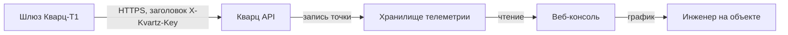

# Архитектура платформы «Кварц»

Эта статья объясняет, как устроена платформа «Кварц»: из каких компонентов она состоит и как телеметрия проходит путь от шлюза до графика в веб-консоли. Статья нужна для понимания работы платформы; конкретные шаги подключения описаны в разделе [Быстрый старт: от API-ключа до первого графика телеметрии](quickstart.md).

## Из чего состоит платформа

Платформа «Кварц» состоит из четырёх компонентов: шлюза Кварц-T1, Кварц API, хранилища телеметрии и веб-консоли. Шлюз — единственный компонент, который стоит у вас на объекте; остальные работают в облаке «Кварца».

- **Шлюз Кварц-T1** собирает показания датчиков и передаёт телеметрию.
- **Кварц API** принимает телеметрию, проверяет ключи и лимиты, отдаёт данные по запросам.
- **Хранилище телеметрии** хранит точки данных всех устройств.
- **Веб-консоль** показывает графики и управляет устройствами и ключами.

## Путь телеметрии от шлюза до графика

Шлюз собирает показания каждые 60 секунд (интервал настраивается от 10 до 600 секунд) и отправляет их в Кварц API по HTTPS — в заголовке `X-Kvartz-Key` передаётся API-ключ. Кварц API проверяет ключ и лимит запросов (100 RPS на базовом тарифе), после чего записывает точку в хранилище телеметрии. Веб-консоль читает данные из хранилища и строит график — путь показан на схеме.

Ключевые факты пути продублированы в тексте: телеметрия передаётся только по HTTPS с заголовком `X-Kvartz-Key`; единственная точка входа — Кварц API; график в веб-консоли строится из хранилища без прямого доступа консоли к шлюзу.

## Почему шлюз подключается только к Кварц API

Единая точка входа упрощает защиту и учёт. Кварц API — единственный компонент, доступный из внешней сети: он проверяет ключ и область (`scope`) каждого запроса, считает лимиты тарифа и записывает данные в хранилище. Шлюз и веб-консоль не обращаются к хранилищу напрямую — это исключает обход проверки ключей и делает весь трафик наблюдаемым в одном месте.

## Зоны ответственности компонентов

Каждый компонент отвечает за свой слой платформы: таблица ниже показывает зоны ответственности и точки взаимодействия между компонентами.

<!-- markdownlint-disable MD018 MD032 -->
#|
|| Компонент | За что отвечает | С кем взаимодействует ||
|| Шлюз Кварц-T1 |
- сбор показаний датчиков
- отправка телеметрии по HTTPS | Кварц API — раз в 60 секунд ||
|| Кварц API |
- проверка ключей и лимитов
- приём и валидация данных | Хранилище телеметрии — запись ||
|| Хранилище телеметрии |
- хранение точек данных
- отдача выборок по периодам | Кварц API и веб-консоль — чтение ||
|| Веб-консоль |
- графики и устройства
- ключи, области и тарифы | Кварц API — чтение данных ||
|#
<!-- markdownlint-enable MD018 MD032 -->

## Частые вопросы

### Что происходит с телеметрией при обрыве связи?

Шлюз буферизует показания локально и отправляет их после восстановления связи. Порядок точек сохраняется — на графике нет пропусков, данные приходят с исходными отметками времени.

### Можно ли записывать телеметрию напрямую в хранилище?

Нет: единственная точка входа — Кварц API с ключом и лимитами. Прямой доступ к хранилищу из внешней сети закрыт — это защищает платформу от обхода проверки ключей.

### Почему у каждого компонента отдельная зона ответственности?

Разделение зон упрощает масштабирование и поиск проблем: сбой шлюза не затрагивает веб-консоль, рост объёма телеметрии решается масштабированием хранилища.
