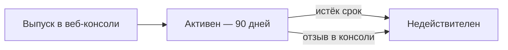

# Модель безопасности платформы «Кварц»

Эта статья объясняет, как устроен доступ к Кварц API: API-ключи, области ключей (scope), срок жизни и ротацию. После прочтения вы сможете выдать доступ объекту и закрыть его без остановки работы. Начало работы с ключами — в разделе [Быстрый старт: от API-ключа до первого графика телеметрии](quickstart.md).

## Ключи — единственный способ доступа

Каждый запрос к Кварц API требует заголовок `X-Kvartz-Key` с API-ключом. Ключ создаётся в веб-консоли в разделе «Ключи» (создание — шаги 1–2 [Быстрого старта](quickstart.md)); значение показывается один раз в момент создания и хранится в зашифрованном виде. Срок жизни ключа — 90 дней; после выпуска ключу присваивается статус «Активен».

## Области ключа (scope)

Область определяет, какие действия разрешены ключу; у одного ключа может быть несколько областей. Платформа использует принцип минимальных привилегий: выдавайте только ту область, которая нужна для задачи.

Области ключей «Кварца» и их назначение:

| Область | Что разрешено | Кому выдаётся |
|---|---|---|
| `telemetry:read` | чтение телеметрии устройств | приложениям и аналитикам |
| `telemetry:write` | отправка телеметрии | только шлюзам Кварц-T1 |
| `devices:manage` | привязка и настройка устройств | администраторам объектов |

## Ротация ключей: смена без остановки работы

Ключи меняют двумя способами. Плановая ротация: выпустите новый ключ в разделе «Ключи» — старый ключ продолжит работать 24 часа после выпуска нового, за это время переведите шлюзы и приложения на новый ключ. Экстренная замена: при компрометации отзовите ключ — отзыв блокирует его мгновенно, без 24-часового окна.



Запросы с отозванным ключом получают ошибку 401 Unauthorized. Прежде чем отзывать ключ, убедитесь, что шлюзы и приложения переведены на новый ключ.



## Жизненный цикл ключа

Статусы в тексте: «Активен» — ключ принимается API; «Недействителен» — истёк срок или выполнен отзыв; запросы с таким ключом получают ошибку 401 Unauthorized.

## Возможные проблемы и варианты решения

### Ключ скомпрометирован — что делать?

Отзовите ключ в разделе «Ключи» — блокировка срабатывает мгновенно. Выпустите новый ключ с нужными областями и переведите шлюзы и приложения на него; повторный просмотр значения отозванного ключа невозможен.

### Можно ли использовать один ключ для всех шлюзов объекта?

Технически да: один ключ с областью `telemetry:write` подойдёт всем шлюзам объекта. Практика минимальных привилегий рекомендует отдельный ключ для каждого объекта — компрометация одного ключа не открывает телеметрию остальных.

### Запросы с новым ключом возвращают 403 — почему?

Код 403 Forbidden означает, что ключ активен, но его область не покрывает действие: например, ключ с областью `telemetry:read` не разрешает отправку телеметрии. Проверьте область ключа в разделе «Ключи» и при необходимости выпустите ключ с нужной областью.
